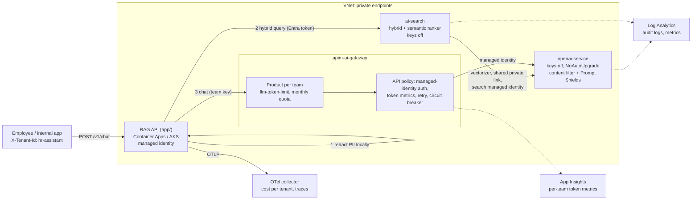

# azure-genai-platform

[](https://github.com/Krustytoe/azure-genai-platform/actions/workflows/terraform.yml) [](https://github.com/Krustytoe/azure-genai-platform/actions/workflows/app.yml) [](https://github.com/Krustytoe/azure-genai-platform/releases/latest) [](LICENSE)

A production-shaped **retrieval-augmented generation (RAG) platform on Azure OpenAI and Azure AI Search**: Terraform for keyless, private, content-filtered AI infrastructure behind an **APIM AI gateway** with per-team token budgets, a FastAPI service that answers questions only from approved documents (with citations), and an eval suite that gates every change.

Works **unchanged in Azure commercial and Azure Government** (`cloud = "usgovernment"`). Token audiences, scopes and authority hosts all switch from one setting.

> AWS version: [aws-genai-platform](https://github.com/Krustytoe/aws-genai-platform). It uses the same API contract, eval suite and design principles on Amazon Bedrock.

## What problem this solves

| Question from security, compliance or finance | Answer in this repo |
|---|---|
| *Are there keys that can leak?* | No. Azure OpenAI and AI Search run with local auth **off**. Every call is an Entra ID identity, and teams only hold revocable gateway keys. |
| *Can it leak PII?* | PII is redacted locally before retrieval and generation, and the API never logs prompt or answer text. |
| *Will it make things up?* | No relevant source means no model call, just a fixed refusal. Answers must cite sources, and semantic-ranker scores gate what counts as relevant. |
| *What about prompt injection in documents?* | The content filter has **Prompt Shields** for direct *and* indirect (document-borne) attacks, and the prompt treats sources as data, never instructions. |
| *Can one team blow the quota?* | Each team gets its own APIM product with a tokens-per-minute limit and monthly quota. A circuit breaker protects the backend. |
| *Who's spending what?* | Token metrics per team and deployment at the gateway, and per-tenant cost metrics (OpenTelemetry) in the app. |
| *Does traffic leave the network?* | Private endpoints for Azure OpenAI and AI Search, and a shared private link for search-to-OpenAI vectorization. |
| *Did a change make answers worse?* | A promptfoo eval and red-team suite runs on every PR, and on demand against a live environment. |

## Architecture



## What's inside

| Path | What it is |
|---|---|
| [`terraform/modules/openai-service`](terraform/modules/openai-service) | Keyless, private Azure OpenAI with a strict content filter (harms + Prompt Shields + protected material) on every deployment, pinned model versions, diagnostics |
| [`terraform/modules/ai-search`](terraform/modules/ai-search) | Keyless, private AI Search with semantic ranker, managed identity, shared private links to a private Azure OpenAI |
| [`terraform/modules/apim-ai-gateway`](terraform/modules/apim-ai-gateway) | APIM AI gateway: per-team products, token limits/quotas, token metrics, managed-identity backend auth, circuit breaker |
| [`terraform/modules/rag-app-access`](terraform/modules/rag-app-access) | Data-plane role assignments for the app, search service and ingestion identities |
| [`terraform/examples/complete`](terraform/examples/complete) | Wires everything together and outputs the app's environment variables |
| [`app/`](app) | The RAG API (redaction, score gating, citations, OpenTelemetry GenAI metrics) and the `ragapi.ingest` index builder |
| [`evals/`](evals) | promptfoo suite (accuracy, refusal, PII, prompt injection) and a sample policy corpus |

## Quick start

**Offline in under a minute**, with no Azure subscription (uses the built-in `fake` provider):

```bash
cd app
uv sync
RAG_PROVIDER=fake uv run uvicorn --factory ragapi.main:create_app --port 8080

curl -s localhost:8080/v1/chat -H 'content-type: application/json' -H 'x-tenant-id: finance' \
  -d '{"question":"What is the domestic meal per diem?"}' | jq
```

**Run the eval suite** against it (another terminal):

```bash
RAG_API_URL=http://localhost:8080 npx promptfoo@0.125.1 eval -c evals/promptfooconfig.yaml
```

**Deploy to Azure:**

```bash
cd terraform/examples/complete
terraform init
terraform apply -var resource_group_name=... -var log_analytics_workspace_id=... \
  -var private_endpoint_subnet_id=... -var openai_private_dns_zone_id=... \
  -var search_private_dns_zone_id=... -var api_management_name=... \
  -var api_management_resource_group_name=... -var app_principal_id=...

terraform output pending_approvals   # approve the search -> Azure OpenAI private link

# Build the index from the sample corpus (or your documents), as the ingestion identity
terraform output -json app_environment | jq -r 'to_entries[] | "export \(.key)=\(.value)"' > /tmp/rag.env
source /tmp/rag.env && (cd ../../../app && uv run python -m ragapi.ingest ../evals/corpus)
```

Then run the container with `app_environment`, plus `RAG_AZURE_OPENAI_API_KEY` set to the team's APIM subscription key from Key Vault.

## Design decisions

- **Identity, not secrets.** Both data services have local auth disabled. The app reaches search with its managed identity, search reaches Azure OpenAI with *its* managed identity, and the gateway reaches Azure OpenAI with *its* managed identity. The only key in the system is a team's gateway subscription key, which can be revoked without touching Azure OpenAI.
- **The gateway is a control point, not a proxy.** Per-team token limits, quotas and metrics live in APIM policy, so they apply to every client, and the app has no direct Azure OpenAI role by default. Teams can't bypass their budget by calling the backend directly.
- **Refuse before you spend.** If no chunk clears `RAG_MIN_SCORE` on the semantic ranker's scale, the API refuses without calling the model. Out-of-scope questions cost nothing and can't produce a hallucinated answer.
- **Treat documents as hostile.** Prompt Shields' indirect-attack detection plus a prompt that fences sources as untrusted data, with tag-breakout neutralised, means a poisoned document can't take over the assistant.
- **Changes go through evals, not surprises.** Model deployments default to `NoAutoUpgrade`, so a new model version is a reviewed change that has to pass the eval suite.
- **Query-time vectorization.** The index carries an Azure OpenAI vectorizer, so the app sends text and AI Search embeds it. There's no embedding code or embedding credential in the request path.
- **Vendor-neutral telemetry.** OpenTelemetry GenAI semantic conventions over OTLP, to Azure Monitor via the collector, Grafana, Datadog or Langfuse, with no code changes.
- **Provider-neutral core.** The pipeline depends only on small `Retriever` and `ChatModel` protocols, and the same code runs on Bedrock in the [AWS repo](https://github.com/Krustytoe/aws-genai-platform).

## CI

| Workflow | What it checks |
|---|---|
| `terraform` | `fmt`, `validate`, `terraform test` (mocked providers, no credentials), and `tflint` for every module |
| `app` | ruff, pytest (90% coverage gate), promptfoo evals against the running API, Docker build + non-root smoke test + Trivy image scan |
| `security` | Trivy IaC misconfiguration and dependency scans to the Security tab, plus a weekly re-scan |
| `evals-deployed` | Manual: run the eval suite against a deployed URL |
| `release-please` | Conventional-commit releases and changelog |

## Related

- [terraform-azure-platform-modules](https://github.com/Krustytoe/terraform-azure-platform-modules): VNet, GitHub OIDC identity and alerting modules this stack sits on
- [platform-workflows](https://github.com/Krustytoe/platform-workflows): the reusable Trivy workflow used here
- [observability-as-code](https://github.com/Krustytoe/observability-as-code): dashboards and alerting as code

## License

[MIT](LICENSE)
